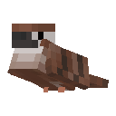
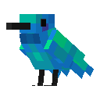
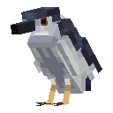
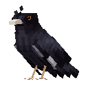
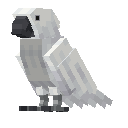
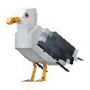

  

# Bird Watching / 哪来的鸟？

我去！哪来的鸟？

树林里有麻雀，花前有悬停的蜂鸟，海边还有惦记食物的海鸥。带上相机出去找鸟，拍到的照片可以挂在家里。能驯服的鸟也会陪你一起出门。

  
  
  
  
  
  

夜鹭会给你带鱼，蜂鸟帮花园里的作物生长。八哥驯服以后，偶尔还会开口说话。

[鸟类与玩法手册](https://www.findedd.cn/mods/bird-watching/docs/) · [官网](https://www.findedd.cn/mods/bird-watching/)

## 下载

[CurseForge](https://www.curseforge.com/minecraft/mc-mods/bird-watching) · [Modrinth](https://modrinth.com/mod/bird-watching)

`main` 对应 **Minecraft 1.20.1 / Forge 47.2.x**，需要 **Java 17** 和 **GeckoLib 4.4.x**。客户端与服务端使用相同的模组版本。

**Minecraft 1.21.1 / NeoForge** 的源码在 [port/1.21.1](https://github.com/EdDYON/there-is-a-bird/tree/port/1.21.1) 分支。

## 公开源码范围

本分支提供 3.9.7 的鸟类、相机、本地照片、装框台和本地相框方案源码。公共相册客户端、在线服务及部署运维资料不在公开范围内，从本仓库构建的版本不包含公共相册入口。

公开源码构建使用独立的联机协议标识；联机双方需使用同一种构建，不能与包含公共相册的完整发行包混用。

This branch contains the public 3.9.7 source for birds, cameras, local photographs, the Frame Workbench, and local frame designs. The online Public Album client, service, and deployment materials are excluded. Builds from this repository have no Public Album entry and use a separate network protocol identifier; both sides of a multiplayer connection must use the same build variant.

遇到 Bug 或有玩法建议，可以 [提个 Issue](https://github.com/EdDYON/there-is-a-bird/issues)。安全漏洞可以 [私密报告](https://github.com/EdDYON/there-is-a-bird/security/advisories/new)。

## 作者

[EdDYON / 蛋炒饭之神](https://www.findedd.cn/)

[Bilibili](https://space.bilibili.com/291012087) · [GitHub](https://github.com/EdDYON) · [MC 百科](https://center.mcmod.cn/1346649/) · [Modrinth](https://modrinth.com/user/EdDYON) · [CurseForge](https://www.curseforge.com/members/eddyon/projects) · [爱发电](https://afdian.com/a/EdDYON)

## 许可

源代码与构建配置采用 [MIT](LICENSE)。模型、几何、骨骼、动画及配套纹理适用 [模型资产限制许可协议](LICENSE-MODELS.md)，不在 MIT 授权范围内；未经单独许可的其他非代码媒体资产保留所有权利。

官方 JAR、项目名称与 Logo 的使用和二次分发见 [发行政策](DISTRIBUTION-POLICY.md)。非官方构建不得冒充正式版本。
